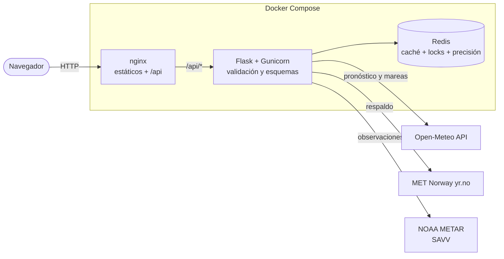
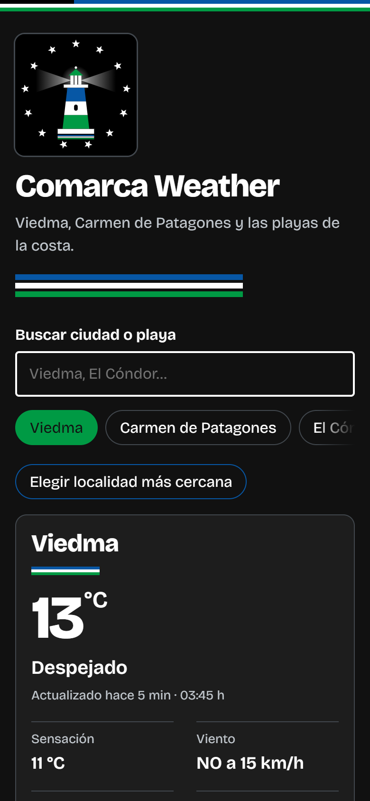

# Clima Comarca

[](https://github.com/l34n-exe/clima-comarca/actions/workflows/ci.yml)

Plataforma para consultar el clima de la Comarca Patagónica (Viedma, Carmen de Patagones y playas cercanas).

**Demo:** <https://clima-comarca.onrender.com> — alojada en Render (plan gratis: puede tardar ~1 minuto en despertar tras un rato sin visitas).

**Stack:** Flask + Redis (caché) en el backend, Svelte + Vite servido por nginx en el frontend.

- Ráfagas de viento, probabilidad de lluvia y salida/puesta del sol.
- Pronóstico horario de 24 horas y tabla de 7 días.
- Selección de localidad por búsqueda o ubicación cercana; la elección queda en el fragmento de URL (`#el-condor`), se conserva al compartir el enlace y se recuerda en el navegador.
- Título de pestaña por localidad, máximos y mínimos marcados en los gráficos, esqueletos de carga y botones de reintento ante errores.
- Pie de página que acredita las fuentes con enlaces y muestra cuál responde en ese momento: Open-Meteo (pronóstico y mareas), MET Norway/yr.no (respaldo) y NOAA (observaciones METAR).

## Correr todo con Docker

```bash
cp .env.example .env
docker compose up --build
```

La API queda en <http://localhost:5000/api/v1> y la web en <http://localhost:8080> (nginx sirve el build de producción y reenvía `/api` al backend).

Para desarrollar el frontend con recarga en caliente: `cd frontend && npm install && npm run dev` (queda en <http://localhost:5173> y el proxy de Vite manda `/api` a Flask, sin conflicto con el 8080 de Docker).

Compose espera a que Redis y la API estén saludables antes de iniciar los servicios que dependen de ellos. El contenedor del backend corre como un usuario sin privilegios (`appuser`), no como root.

Variables de entorno configurables en `.env` (ver `.env.example`):

| Variable                  | Qué hace                                                      | Valor por defecto                                      |
|---------------------------|---------------------------------------------------------------|--------------------------------------------------------|
| `REDIS_URL`               | Conexión a Redis (caché, locks, precisión, rate limit)        | `redis://localhost:6379/0`                             |
| `CORS_ORIGINS`            | Orígenes permitidos, separados por comas                      | `http://localhost:5173`                                |
| `CACHE_TTL_CURRENT`       | Frescura del clima actual (segundos)                          | `600`                                                  |
| `CACHE_TTL_FORECAST`      | Frescura del pronóstico (segundos)                            | `3600`                                                 |
| `CACHE_TTL_TIDES`         | Frescura de las mareas (segundos)                             | `21600`                                                |
| `CACHE_TTL_OBSERVATION`   | Frescura de la observación METAR (segundos)                   | `600`                                                  |
| `CACHE_STALE_EXTRA`       | Retención extra del dato viejo para `stale` (segundos)        | `86400`                                                |
| `HTTP_TIMEOUT`            | Timeout por request a los proveedores (segundos)              | `8`                                                    |
| `HTTP_RETRIES`            | Reintentos ante 5xx o fallos de red (un 429 no reintenta)     | `3`                                                    |
| `HTTP_RETRY_BACKOFF`      | Backoff base exponencial entre reintentos (segundos)          | `0.5`                                                  |
| `WEATHER_MODELS`          | Modelos comparados en `/models` (mínimo 2, por comas)         | `ecmwf_ifs025,gfs_global,icon_global,gem_global`       |
| `METAR_URL`               | Endpoint METAR decodificado; debe contener `{station}`        | `https://tgftp.nws.noaa.gov/.../decoded/{station}.TXT` |
| `OBSERVATION_MAX_AGE_MIN` | Antigüedad máxima aceptable de la observación (min)           | `180`                                                  |
| `RATE_LIMIT_STORAGE_URI`  | Storage del límite de peticiones; vacío = memoria por proceso | —                                                      |

Los TTL pueden ser cero para desactivar la frescura del caché, pero no negativos. `RATE_LIMIT_STORAGE_URI` con una URL `redis://` comparte el límite entre todos los workers (en Render se setea solo desde la Key Value).

La API limita a 120 peticiones por minuto por IP real del cliente (nginx la resuelve con `realip` saltando Cloudflare y la red interna de Render) y registra cada request con un `X-Request-ID`. Cuando una clave de caché vence, un candado en Redis evita que varias peticiones simultáneas salgan a buscar el mismo dato.

## Publicar

### Render (plan gratis)

`render.yaml` es un blueprint listo para usar:

1. Subí el repo a GitHub.
2. En Render: **New → Blueprint** y elegí el repo. Detecta los 3 servicios.
3. Esperá el deploy (~5 min la primera vez) y entrá a `https://clima-comarca.onrender.com`.

Limitaciones del plan gratis: el sitio duerme tras 15 minutos sin tráfico (la primera visita tarda ~1 minuto en despertar) y la Key Value gratuita guarda los datos solo en memoria: se pierden cada vez que la instancia se reinicia, y Render puede reiniciarla o darle mantenimiento en cualquier momento. El caché se regenera solo, pero el historial de precisión puede volver a empezar de cero sin aviso.

### VPS u otro host con Docker

```bash
docker compose -f docker-compose.prod.yml --env-file .env up -d --build
```

`docker-compose.prod.yml` no expone Redis ni el backend: solo nginx queda en el puerto 80 y reenvía `/api` al backend por la red interna. Los servicios reinician solos y Redis guarda sus datos en un volumen. Sirve igual para Railway, Fly.io o cualquier VPS con Docker; en esos casos cada servicio se despliega por separado y hay que apuntar `API_UPSTREAM` al host interno del backend.

## Arquitectura



El frontend nunca habla directo con los proveedores: todo pasa por la API, que valida las respuestas con esquemas antes de servirlas.

## Decisiones de diseño

- **Redis como caché**: las APIs externas tienen límites y latencia; cachear por tipo de dato (clima actual 10 min, pronóstico 1 h, mareas 6 h) hace la app rápida y amable con los proveedores. El dato viejo se guarda `CACHE_STALE_EXTRA` (24 h) como respaldo.
- **`stale` explícito**: cuando el proveedor falla y se sirve un dato viejo, la respuesta lo marca con `stale: true` y la UI lo indica. Es preferible mostrar información vencida y señalada que un error vacío.
- **Candado anti-stampede**: al vencer una clave, un `SET NX EX` en Redis hace que un solo request salga a buscar el dato; el resto espera y lee el caché.
- **Mareas como estimación**: salen del modelo marino global de Open-Meteo (~8 km de resolución), no de tablas de mareas locales. Sirven para planificar, no para navegar; la respuesta incluye un `aviso` y la sección correspondiente lo aclara.
- **Precisión medida, no prometida**: en vez de decir "el modelo es bueno", la app registra la estimación vs. la observación METAR real de Viedma y muestra el error promedio de los últimos días. Los números se construyen con el uso.
- **Proveedor de respaldo**: si Open-Meteo falla (rate limit, caída), el clima actual y el pronóstico se piden a MET Norway (yr.no). Un 429 no se reintenta —reintentar contra un limitador empeora el bloqueo— así que el respaldo toma el control de inmediato. El respaldo no tiene comparación de modelos, probabilidad de lluvia oficial ni ráfagas: la probabilidad se estima por la precipitación prevista y las ráfagas quedan en `null` (la UI las oculta). Cada respuesta indica su `fuente` y el pie de página la muestra. Si ambos proveedores fallan, se sirve el último dato cacheado marcado como `stale`.

## Capturas

| Escritorio | Móvil |
| ---------- | ----- |
|  |  |

## Endpoints

| Método | Ruta                             | Descripción                                        |
| ------ | -------------------------------- | -------------------------------------------------- |
| GET    | `/api/v1/locations?q=`           | Lista o busca localidades                          |
| GET    | `/api/v1/weather/<slug>`         | Clima actual                                       |
| GET    | `/api/v1/forecast/<slug>`        | Pronóstico a 7 días                                |
| GET    | `/api/v1/tides/<slug>`           | Pleamares, bajamares y serie horaria (solo playas) |
| GET    | `/api/v1/models/<slug>`          | Comparación de temperaturas entre modelos          |
| GET    | `/api/v1/observation/<slug>`     | Observación METAR/NOAA de una estación             |
| GET    | `/api/v1/accuracy/<slug>?dias=7` | Error promedio del modelo vs. observación METAR    |
| GET    | `/api/v1/health`                 | Estado de Flask y Redis                            |

## Sobre la precisión del modelo

Cada vez que se consulta `/api/v1/accuracy/<slug>` (la app lo hace junto con el resto de los datos), el backend guarda en Redis una muestra por hora UTC: la temperatura estimada por el proveedor activo y la observada por el METAR de la estación. Repetir la consulta dentro de la misma hora fusiona el registro en vez de duplicarlo. Solo se registran estimaciones de Open-Meteo: si el respaldo MET Norway está respondiendo, la muestra guarda la observación pero no la estimación, para no mezclar dos modelos en el promedio. Los datos viejos se descartan solos al leer: el hash tiene TTL y las estadísticas (`?dias=`, hasta 30) solo usan los últimos días pedidos. Devuelve error absoluto promedio (MAE), error máximo, sesgo (si el modelo sobreestima o subestima) y el detalle por día. Solo aplica a localidades con estación (`estacion` en `locations.json`, hoy Viedma/SAVV).

Ojo con qué mide: compara la temperatura **actual** del modelo contra el termómetro, no el pronóstico con horas de anticipación. La estimación "actual" de Open-Meteo ya viene ajustada con observaciones, así que un error bajo no prueba que el modelo pronostique bien: solo muestra que se parece al termómetro en el presente.

## Sobre las mareas

Salen del modelo marino global de Open-Meteo (variable `sea_level_height_msl`, resolución ~8 km). Las pleamares y bajamares se calculan en el backend buscando máximos y mínimos de la serie horaria. Es una estimación: puede diferir de las tablas oficiales y no sirve para navegar. La respuesta incluye un campo `aviso` con esto.

## Limitaciones conocidas

- **Plan gratis de Render**: el sitio duerme tras 15 minutos sin tráfico (~1 minuto de espera en la primera visita, con reintentos automáticos en el frontend) y la Key Value guarda los datos solo en memoria: se pierden en cada reinicio de la instancia, que Render puede hacer en cualquier momento. El historial de precisión puede volver a empezar de cero sin aviso.
- **Precisión**: mide la temperatura actual vs. METAR, no el pronóstico con anticipación (ver sección dedicada). Además solo acumula datos cuando alguien consulta la app: sin visitas no hay muestras nuevas.
- **Mareas**: estimación del modelo marino global (~8 km), no tablas de mareas oficiales; en comparaciones puntuales los horarios difirieron en alrededor de una hora y las alturas no coinciden con las tablas. No sirve para navegar.
- **Respaldo MET Norway**: sin ráfagas, sin comparación de modelos y con probabilidad de lluvia estimada; el pie de página avisa cuándo está activo.
- **Rate limit**: 120 req/min por IP; si se supera, la API responde 429 y el frontend muestra el error hasta que se libera la ventana.

## Fuentes de datos

- [Open-Meteo](https://open-meteo.com/) — pronóstico, comparación de modelos y mareas (gratuita, sin API key).
- [MET Norway](https://api.met.no/) — proveedor de respaldo para clima actual y pronóstico (gratuita; pide User-Agent identificable, que el cliente envía).
- [NOAA](https://tgftp.nws.noaa.gov/) — observaciones METAR de la estación SAVV (Viedma), servidas desde el servidor de datos del National Weather Service.

Condiciones de uso verificadas en noviembre de 2026 (cada servicio puede cambiarlas; enlaces a los textos originales):

- **[Open-Meteo](https://open-meteo.com/en/terms)**: datos CC BY 4.0, exige atribución con enlace visible ("Weather data by Open-Meteo.com"); la API gratuita es solo para uso no comercial y limita a ~10.000 llamadas/día, 5.000/hora y 600/minuto por IP — de ahí el caché y el respaldo del diseño.
- **[MET Norway](https://api.met.no/doc/TermsOfService)**: también CC BY 4.0 y exige un User-Agent identificable (el cliente envía `clima-comarca/1.0` con el enlace al repo), tope de ~20 req/s y coordenadas truncadas a 4 decimales — ambas reglas ya implementadas.
- **[NOAA/NWS](https://www.weather.gov/disclaimer/)**: dominio público, sin atribución obligatoria (basta no presentarlo como propio ni insinuar afiliación); la app la incluye igual.

## Tests

```bash
cd backend
pip install -r requirements-dev.txt
pytest
```

Los tests usan `fakeredis` y clientes simulados: no necesitan Docker ni acceso a los proveedores externos.

## Licencia

El código es [MIT](LICENSE) (Copyright (c) 2026 Leandro Hidalgo). Ojo: la licencia CC BY 4.0 que se menciona en "Fuentes de datos" aplica a los **datos** de los proveedores, no al código de este proyecto.
