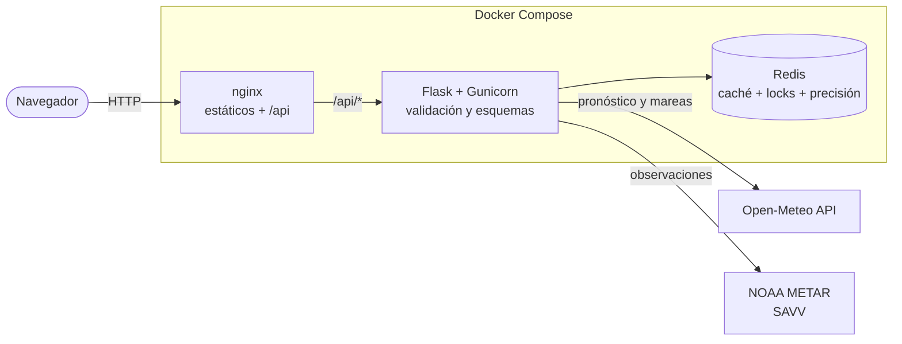
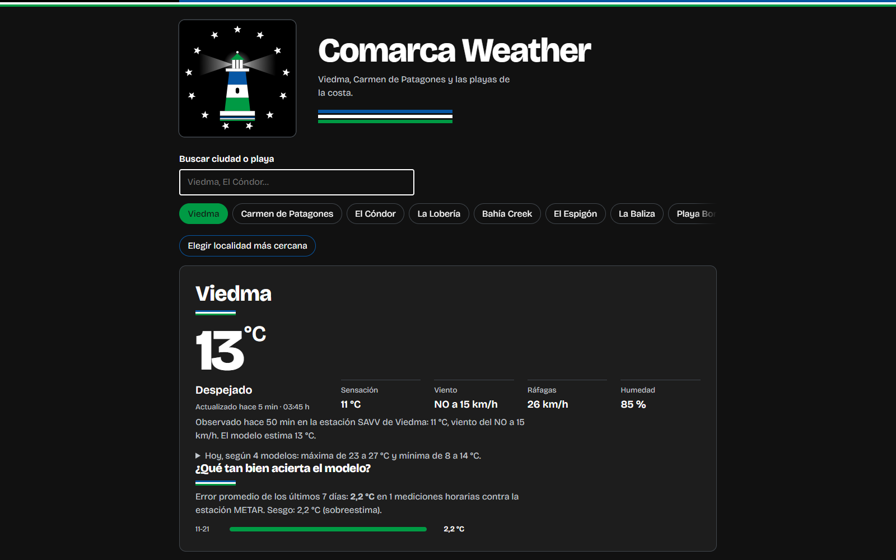

# Clima Comarca

[](https://github.com/l34n-exe/clima-comarca/actions/workflows/ci.yml)

Plataforma para consultar el clima de la Comarca Patagónica (Viedma, Carmen de Patagones y playas cercanas).

**Stack:** Flask + Redis (caché) en el backend, Svelte + Vite servido por nginx en el frontend.

Incluye ráfagas de viento, probabilidad de lluvia, salida y puesta del sol, pronóstico horario de 24 horas y selección de localidad por búsqueda o ubicación cercana. La localidad seleccionada queda en el fragmento de URL (por ejemplo, `#el-condor`) y se conserva al compartir el enlace; además se recuerda en el navegador para la próxima visita. El título de la pestaña cambia según la localidad (`Clima en El Cóndor · Comarca Weather`), los gráficos horarios marcan máximos y mínimos con sus valores, y la página muestra esqueletos de carga y botones de reintento ante errores. Un pie de página acredita las fuentes: Open-Meteo (pronóstico y mareas) y NOAA (observaciones METAR).

## Correr todo con Docker

```bash
cp .env.example .env
docker compose up --build
```

La API queda en <http://localhost:5000/api/v1> y la web en <http://localhost:8080> (nginx sirve el build de producción y reenvía `/api` al backend).

Para desarrollar el frontend con recarga en caliente: `cd frontend && npm install && npm run dev` (queda en <http://localhost:5173> y el proxy de Vite manda `/api` a Flask, sin conflicto con el 8080 de Docker).

Compose espera a que Redis y la API estén saludables antes de iniciar los servicios que dependen de ellos. Los TTL del caché, `CACHE_STALE_EXTRA` y `HTTP_TIMEOUT` se pueden ajustar en `.env`; los TTL pueden ser cero para desactivar la frescura del caché, pero no negativos. `CORS_ORIGINS` acepta una lista de orígenes separada por comas. El contenedor del backend corre como un usuario sin privilegios (`appuser`), no como root.
Las variables `WEATHER_MODELS`, `METAR_URL`, `CACHE_TTL_OBSERVATION` y `OBSERVATION_MAX_AGE_MIN` controlan la comparación de modelos y las observaciones meteorológicas. `WEATHER_MODELS` debe incluir al menos dos modelos separados por comas, `METAR_URL` debe contener `{station}` y `OBSERVATION_MAX_AGE_MIN` debe ser mayor que cero. `HTTP_RETRIES` y `HTTP_RETRY_BACKOFF` ajustan los reintentos ante fallos transitorios de los proveedores.

La API limita a 120 peticiones por minuto por IP (`X-Forwarded-For` vía nginx) y registra cada request con un `X-Request-ID`. Cuando una clave de caché vence, un candado en Redis evita que varias peticiones simultáneas salgan a buscar el mismo dato.

## Publicar

### Render (gratis, sin tarjeta)

`render.yaml` es un blueprint listo para usar:

1. Subí el repo a GitHub.
2. En Render: **New → Blueprint** y elegí el repo. Detecta los 3 servicios.
3. Esperá el deploy (~5 min la primera vez) y entrá a `https://clima-comarca.onrender.com`.

Limitaciones del plan gratis: el sitio duerme tras 15 minutos sin tráfico (la primera visita tarda ~1 minuto en despertar) y la Key Value de Redis expira a los 30 días (se renueva desde el dashboard; el caché y el historial de precisión se regeneran solos).

### VPS u otro host con Docker

```bash
docker compose -f docker-compose.prod.yml --env-file .env up -d --build
```

`docker-compose.prod.yml` no expone Redis ni el backend: solo nginx queda en el puerto 80 y reenvía `/api` al backend por la red interna. Los servicios reinician solos y Redis guarda sus datos en un volumen. Sirve igual para Railway, Fly.io o cualquier VPS con Docker; en esos casos cada servicio se despliega por separado y hay que apuntar `API_UPSTREAM` al host interno del backend.

## Arquitectura



El frontend nunca habla directo con los proveedores: todo pasa por la API, que valida las respuestas con esquemas antes de servirlas.

## Decisiones de diseño

- **Redis como caché**: las APIs externas tienen límites y latencia; cachear por tipo de dato (clima actual 10 min, pronóstico 1 h, mareas 6 h) hace la app rápida y amable con los proveedores. El dato viejo se guarda `CACHE_STALE_EXTRA` (24 h) como respaldo.
- **`stale` explícito**: cuando el proveedor falla y se sirve un dato viejo, la respuesta lo marca con `stale: true` y la UI lo indica. Es preferible mostrar información vencida y señalada que un error vacío.
- **Candado anti-stampede**: al vencer una clave, un `SET NX EX` en Redis hace que un solo request salga a buscar el dato; el resto espera y lee el caché.
- **Mareas como estimación**: salen del modelo marino global de Open-Meteo (~8 km de resolución), no de tablas de mareas locales. Sirven para planificar, no para navegar; la respuesta incluye un `aviso` y la sección correspondiente lo aclara.
- **Precisión medida, no prometida**: en vez de decir "el modelo es bueno", la app registra cada hora la estimación vs. la observación METAR real de Viedma y muestra el error promedio de los últimos días. Los números se construyen con el uso.

## Capturas

<!-- Agregá capturas en docs/screenshots/ y reemplazá los enlaces.
     Recomendado: 1600×900 o 1920×1080, modo claro u oscuro. -->

| Escritorio | Móvil |
| ---------- | ----- |
|  |  |

## Endpoints

| Método | Ruta                             | Descripción                                        |
| ------ | -------------------------------- | -------------------------------------------------- |
| GET    | /api/v1/locations?q=             | Lista o busca localidades                          |
| GET    | /api/v1/weather/< slug >         | Clima actual                                       |
| GET    | /api/v1/forecast/< slug >        | Pronóstico a 7 días                                |
| GET    | /api/v1/tides/< slug >           | Pleamares, bajamares y serie horaria (solo playas) |
| GET    | /api/v1/models/< slug >          | Comparación de temperaturas entre modelos          |
| GET    | /api/v1/observation/< slug >     | Observación METAR/NOAA de una estación             |
| GET    | /api/v1/accuracy/< slug >?dias=7 | Error promedio del modelo vs. observación METAR    |
| GET    | /api/v1/health                   | Estado de Flask y Redis                            |

## Sobre la precisión del modelo

Cada vez que se consulta `/api/v1/accuracy/<slug>` (la app lo hace junto con el resto de los datos), el backend guarda en Redis la temperatura estimada por Open-Meteo y la observada por el METAR de la estación, indexadas por hora UTC. Repetir la consulta dentro de la misma hora fusiona el registro en vez de duplicarlo. Los datos viejos se descartan solos al leer: el hash tiene TTL y las estadísticas (`?dias=`, hasta 30) solo usan los últimos días pedidos. Devuelve error absoluto promedio (MAE), error máximo, sesgo (si el modelo sobreestima o subestima) y el detalle por día. Solo aplica a localidades con estación (`estacion` en `locations.json`, hoy Viedma/SAVV).

## Sobre las mareas

Salen del modelo marino global de Open-Meteo (variable `sea_level_height_msl`, resolución ~8 km). Las pleamares y bajamares se calculan en el backend buscando máximos y mínimos de la serie horaria. Es una estimación: puede diferir de las tablas oficiales y no sirve para navegar. La respuesta incluye un campo `aviso` con esto.

## Tests

```bash
cd backend
pip install -r requirements-dev.txt
pytest
```

Los tests usan `fakeredis` y clientes simulados: no necesitan Docker ni acceso a los proveedores externos.
